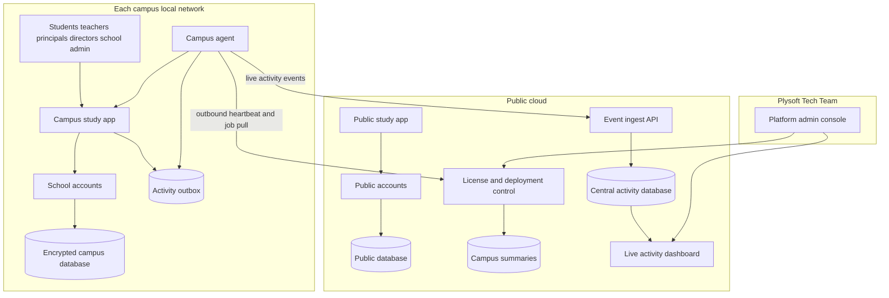
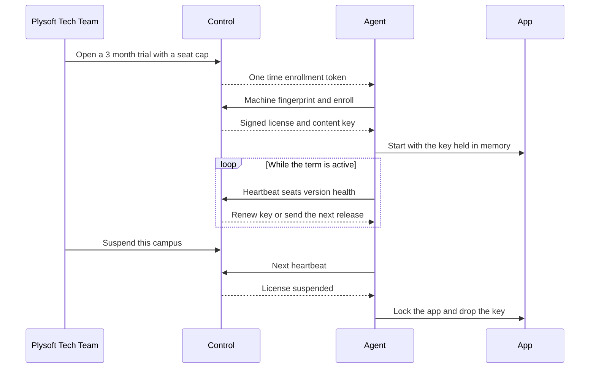

# Architecture

Two products share one codebase and one owner console:

1. **Public cloud**: the online app for anyone with internet, plus the control service the Plysoft Tech Team uses to manage campuses.
2. **Campus appliance**: a signed package installed on each campus server. Students and staff use it over the campus local network.

Student devices never need the internet. Each campus server needs one narrow outbound HTTPS connection to the control service. Without it, remote licensing, releases, and suspension cannot be guaranteed.

## System overview

## Components

### Platform admin console (cloud)

Used only by the Plysoft Tech Team. Creates schools and campuses, sets trials and seat caps, starts releases, suspends campuses, and shows each deployment's version, last heartbeat, and seat use.

### Control service (cloud)

Signs licenses, issues enrollment tokens, releases short-lived content and database keys, hosts signed release images, and receives heartbeats and campus summaries. It never opens connections into a campus network.

### Event ingest and live activity (cloud)

Receives activity events from every campus agent within seconds, stores them in the central activity database, and streams updates to live dashboards for directors and the Plysoft Tech Team. See [realtime-activity.md](./realtime-activity.md).

### Public study app (cloud)

The current dashboard and labs, with public sign-in and a learner's own activity history. Public accounts are separate from school accounts.

### Campus study app (campus server)

The same dashboard and labs plus school features: invites, approvals, tasks, submissions, and principal views. Serves browsers on the campus network only.

### Campus agent (campus server)

The only process that talks to the internet. It:

- Enrolls the server with a one-time token and a machine fingerprint.
- Pulls signed releases and verifies the signature before installing.
- Renews the license and keys on every heartbeat.
- Reports version, health, and approved seat count.
- Uploads campus summaries for directors.
- Forwards activity events from the outbox in near real time, and holds them while offline.
- Locks the campus app when the license is suspended or expired after the grace period.

### Campus database (campus server)

Holds school accounts, tasks, submissions, learning events, and the activity outbox for that campus. Encrypted at rest. The key is released by the control service and held in memory and the operating system key store. See [security.md](./security.md).

## License and deployment lifecycle

## Data flow rules

- Student and staff browsers talk only to the campus app.
- The agent pulls from the control service. The control service never pushes into the campus.
- The campus server is the source of truth for learner records.
- Activity events stream to the central activity database within seconds. By default user identities are replaced with campus-specific codes; the detail level is set per school in its data agreement. See [realtime-activity.md](./realtime-activity.md).
- Aggregated summaries (completion by class, usage by subject, active seats) also leave the campus, so directors can see every campus.
- Public and campus accounts never mix.

## Content packaging

The lessons and simulations in `public/labs/` ship in two places:

- The public cloud build, as today.
- The signed campus image, with Netlify scripts removed and every asset served locally.

To record learning activity, the labs need a small reporting hook (lesson opened, simulation started, time spent) that posts to the hosting app. Keep the original simulation logic intact.
