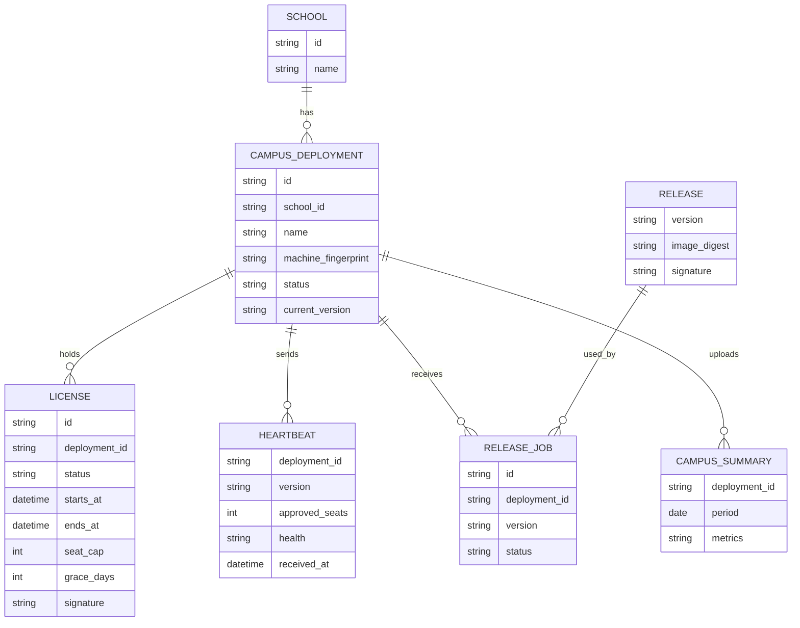
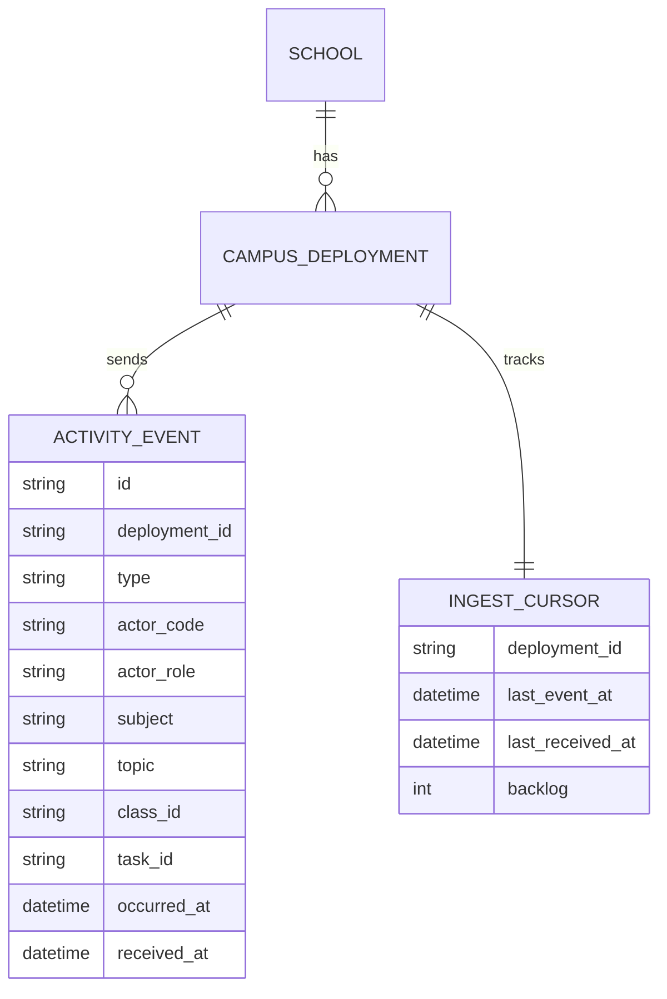

# Domain model

A starting model for the campus database, the public database, and the control service. Names and fields will change as phases are built.

## Campus database

```mermaid
erDiagram
  CAMPUS ||--o{ USER : has
  CAMPUS ||--o{ CLASS : has
  CLASS ||--o{ ENROLLMENT : has
  USER ||--o{ ENROLLMENT : joins
  CLASS ||--o{ TASK : receives
  USER ||--o{ TASK : creates
  TASK ||--o{ SUBMISSION : collects
  USER ||--o{ SUBMISSION : makes
  USER ||--o{ LEARNING_EVENT : produces
  USER ||--o{ INVITE : receives
  CAMPUS ||--o{ AUDIT_LOG : records
  CAMPUS ||--o{ OUTBOX_EVENT : queues

  CAMPUS {
    string id
    string school_id
    string name
  }
  USER {
    string id
    string campus_id
    string role
    string status
    string display_name
    string password_hash
  }
  CLASS {
    string id
    string campus_id
    string name
    string subject
  }
  ENROLLMENT {
    string class_id
    string user_id
    string role
  }
  TASK {
    string id
    string class_id
    string teacher_id
    string subject
    string topic
    string lab_path
    datetime due_at
  }
  SUBMISSION {
    string id
    string task_id
    string student_id
    string status
    datetime submitted_at
  }
  LEARNING_EVENT {
    string id
    string user_id
    string subject
    string topic
    string type
    int duration_seconds
    datetime occurred_at
  }
  INVITE {
    string code
    string campus_id
    string role
    datetime expires_at
  }
  AUDIT_LOG {
    string id
    string actor_id
    string action
    datetime occurred_at
  }
  OUTBOX_EVENT {
    string id
    string campus_id
    string type
    string actor_code
    string actor_role
    string payload
    datetime occurred_at
    datetime sent_at
  }
```

- `USER.role`: `school_admin`, `teacher`, `student`, `principal`, `director`.
- `USER.status`: `invited`, `pending`, `active`, `disabled`.
- `LEARNING_EVENT.type`: `lesson_opened`, `simulation_started`, `simulation_completed`, `task_opened`.
- `SUBMISSION.status`: `not_started`, `in_progress`, `submitted`, `reviewed`.
- `OUTBOX_EVENT` is written in the same transaction as the change it describes. `sent_at` is set when the ingest API acknowledges it. `actor_code` is the campus-specific pseudonym unless the school's agreement allows identities. Event types are listed in [realtime-activity.md](./realtime-activity.md).

## Control service



- `LICENSE.status`: `trial`, `active`, `suspended`, `expired`.
- `CAMPUS_DEPLOYMENT.status`: `pending_enrollment`, `enrolled`, `locked`, `retired`.
- `RELEASE_JOB.status`: `queued`, `downloading`, `installed`, `failed`, `rolled_back`.
- `CAMPUS_SUMMARY.metrics` holds aggregates only, never individual student records.

## Central activity database



- `ACTIVITY_EVENT.id` comes from the campus outbox, so a resent event is stored once.
- `INGEST_CURSOR` lets the live dashboard show each campus's lag and unsent backlog.

## Public database

Public learners, their sessions, and their own learning events. It shares the `LEARNING_EVENT` shape but has no campus, class, or task tables.
