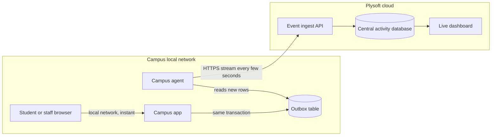

# Real-time activity tracking

Every campus sends its activity to a central database within seconds, so directors and the Plysoft Tech Team can watch all campuses live. Student devices stay offline: they report to the campus server over the local network, and the campus agent forwards events over its existing outbound HTTPS connection.

## Flow

1. **Record on campus.** When a user signs in, opens a lesson, creates a task, or submits work, the campus app writes the change and an outbox event in the same database transaction. An event is never lost, and never recorded without its change.
2. **Forward.** The agent reads new outbox rows and sends them in small batches as they appear, over a persistent WebSocket or repeated HTTPS calls.
3. **Survive outages.** If the campus loses internet, events wait in the outbox and send when the connection returns. Each event has a unique id, so a resend never creates a duplicate.
4. **Store centrally.** The ingest API checks the sending campus and its license, then writes the events to the central activity database.
5. **Show live.** Dashboards update through server-sent events or WebSockets.

The agent marks outbox rows as sent only after the ingest API acknowledges them. Sent rows are pruned after a retention period.

## Events

| Event | Produced when |
| --- | --- |
| `user.signed_in`, `user.signed_out` | A session starts or ends |
| `user.invited`, `user.approved`, `user.disabled`, `user.enabled` | The school admin manages an account |
| `task.created`, `task.updated`, `task.assigned` | A teacher sets or changes work |
| `submission.started`, `submission.submitted`, `submission.reviewed` | A student works on a task, or a teacher reviews it |
| `lesson.opened` | A learner opens a syllabus topic |
| `simulation.started`, `simulation.completed` | A learner uses a lab simulation |

Each event carries: event id, campus id, event type, actor code, actor role, subject and topic when relevant, related task or class id, and the time it occurred on campus.

## What the dashboards show

- Users signed in right now, per campus.
- Accounts invited, approved, and disabled.
- Tasks created and submissions handed in, as they happen.
- Lessons opened and simulations used, by subject and topic.
- Per campus: time of the last event received and the size of any unsent backlog.

"Real time" means seconds, not instant. When a campus is offline, the dashboard shows its lag and the time of its last event instead of presenting old figures as current.

## Detail level

How much student detail leaves the campus must be agreed with each school before the pilot.

| Option | What reaches the cloud | Trade-off |
| --- | --- | --- |
| Live counts only | Numbers per campus, class, and subject, updated every few seconds | Keeps all student records on campus. No central drill-down to a single student |
| Pseudonymous events (proposed default) | Each event, with user ids replaced by campus-specific codes | Detailed trends without names. Only the campus server can match a code to a person |
| Full events | Each event with the user's identity | Full visibility in one place. Student records then live in the cloud, which needs consent, a retention policy, and rules on which Plysoft staff may see them |

With pseudonymous events, a director viewing a single student's history opens it on the campus app, or the central view asks the campus to resolve the code while the viewer is authorized.

Pseudonymous codes are derived per campus with a secret held on the campus server, so the same student cannot be linked across campuses or recovered by the cloud.

## Security

- Events travel over HTTPS from the agent, signed with the campus deployment key.
- The ingest API rejects events from a suspended, expired, or unknown deployment.
- The central activity database is encrypted at rest and separate from the public app's database.
- Directors see only their school. Plysoft staff access to activity data is limited and logged.

## Bandwidth

Events are small JSON records. A campus with a few thousand students produces modest traffic, and batches are compressed. If a campus connection is very slow, the agent sends live counts first and detailed events behind them.
