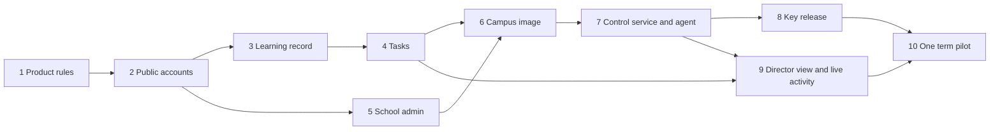

# Roadmap

Build school features on the public cloud first with a test school, so roles and tasks work before any campus server is involved. Package the campus appliance only after a teacher can assign work and see it recorded. Run one campus for a full term before offering the installer to every campus.

## Phases

### 1. Product rules

Agree on schools, campuses, roles, the 3 month trial, seat caps, and the rule that student devices stay on the local network. Confirm with the first school that each campus server can make outbound HTTPS calls.

Exit: signed-off role list, license terms, and network requirement.

### 2. Public accounts

Add sign-in, sign-out, and authorization to the online app. Public accounts stay separate from school accounts.

Exit: a public learner can sign up, sign in, and only reach their own data.

### 3. Learning record

Add a reporting hook to the three labs for lessons opened, simulations used, and time spent. Store events for signed-in learners. Keep the original simulation logic intact.

Exit: a learner sees their own recorded activity. Nothing is shown that was not recorded.

### 4. Tasks

Teachers create tasks on syllabus topics or labs and assign them to classes. Students open and submit them. Teachers and principals see completion.

Exit: a teacher assigns a task, a student completes it, and the teacher sees the result.

### 5. School admin

Invite codes and class list import, approval, disable and re-enable, and seat cap enforcement.

Exit: a school admin onboards a class and cannot approve past the cap.

### 6. Campus image

Package the app, database, and labs as one signed image that serves the campus local network with no internet access for students. Remove Netlify scripts from the labs.

Exit: the image runs on a test server with student devices offline.

### 7. Control service and campus agent

The platform admin console: create trials, issue enrollment tokens, publish releases with a rollout schedule, show heartbeats and seat use, suspend campuses. Build the campus agent in Go (option 1; TypeScript on Node.js is option 2) using scheduled pull: download early, install only inside the campus maintenance window, health check, automatic rollback. See [licensing-and-deployment.md](./licensing-and-deployment.md).

Exit: a test campus enrolls, installs an update inside its maintenance window, rolls back a deliberately bad release, and locks on suspension.

### 8. Key release

Encrypted database and backups, short-lived keys bound to the machine fingerprint, signed licenses, watermarking, and locked mode after the grace period.

Exit: a copied install and a copied database both fail to open on another machine.

### 9. Director view and live activity

Each campus writes activity to an outbox, and the agent streams it to the central activity database within seconds. Directors and the Plysoft Tech Team see a live dashboard across campuses. Principals keep using local campus data. See [realtime-activity.md](./realtime-activity.md).

Exit: a task created or submitted on any campus appears on the central dashboard within seconds; a campus that goes offline shows its lag and catches up without duplicates; identities leave a campus only at the detail level the school agreed.

### 10. One-term pilot

One campus runs a full term on the appliance under a trial license. The public site stays live for everyone else.

Exit: three months of use, the trial ends as designed, and the school decides whether to convert to an active license and add campuses.

## Phase summary

| Phase | Outcome | Depends on |
| --- | --- | --- |
| 1 | Product rules agreed | First school's agreement on outbound access |
| 2 | Public accounts | 1 |
| 3 | Learning record | 2 |
| 4 | Tasks | 3 |
| 5 | School admin | 2 |
| 6 | Campus image | 4, 5 |
| 7 | Control service and campus agent | 6 |
| 8 | Key release | 7 |
| 9 | Director view and live activity | 4, 7 |
| 10 | One-term pilot | 8, 9 |
