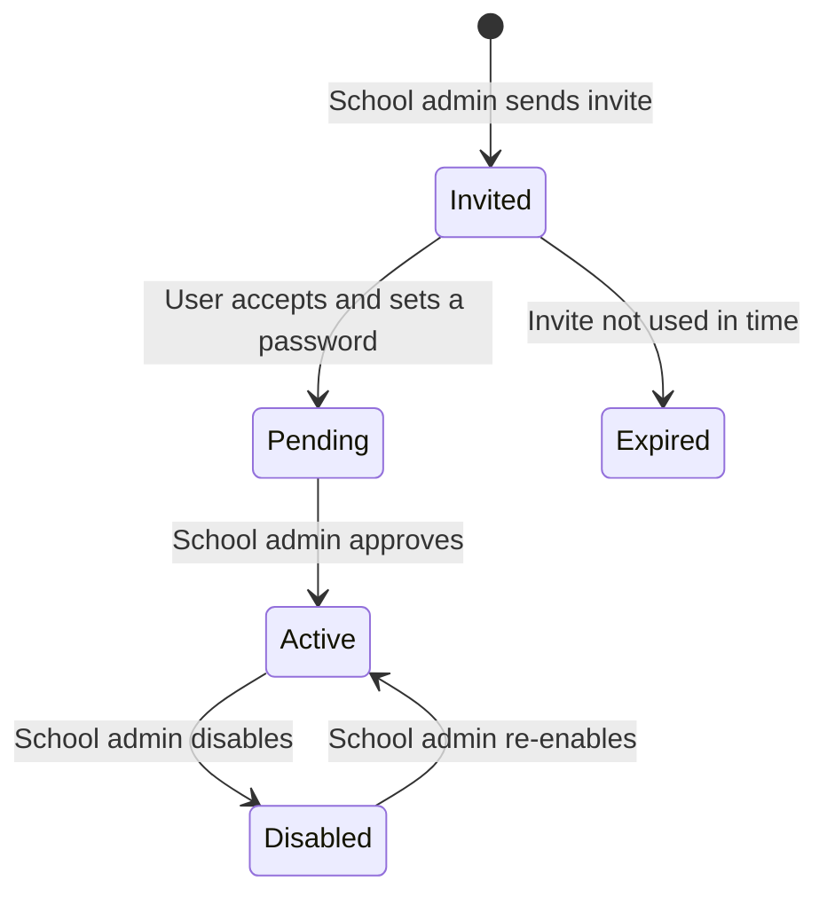

# Roles and permissions

## Roles

| Role | Where they sign in | What they can do |
| --- | --- | --- |
| Platform admin (Plysoft Tech Team) | Cloud console only | Create schools and campuses, set the 3 month trial, set seat caps, start releases, suspend campuses, see deployment health |
| School admin | That campus app | Invite teachers and students, approve or disable them, stay within the seat cap |
| Teacher | That campus app | Set tasks on syllabus topics, see submissions and lab activity for their classes |
| Student | That campus app | See and complete assigned tasks, use the labs. Activity is recorded on the campus server |
| Principal | That campus app | See their campus: classes, task completion, and usage |
| Director | Cloud portal and any campus app | See every campus in their school, live, from activity events and summaries sent by each campus agent |
| Campus IT operator | Campus server operating system | Start and stop services, watch disk space, hold encrypted backups. No database access |
| Public learner | Public cloud app | Own account and own activity only. No school data |

## Scope rules

- A school contains one or more campuses. Every campus user belongs to exactly one campus.
- Principals see only their campus.
- Directors see all campuses of their school. On the cloud portal they see live activity at the detail level the school agreed (pseudonymous by default) and open named student records on the campus app.
- Teachers see only students in classes they teach.
- Students see only their own work.
- The school admin manages users only on their campus.
- Platform admins manage licenses and deployments. They do not read campus learner records.

## User lifecycle

- An approval fails when it would push approved users above the license seat cap.
- Disabled users cannot sign in. Their recorded work stays for teachers and principals.
- Because student devices are offline, invites cannot rely on email. The school admin issues invite codes or bulk imports a class list, and students set a password on first sign-in.

## Permission checks

Enforce every check on the server. Hiding a button in the UI is not authorization.

| Action | Platform admin | School admin | Teacher | Student | Principal | Director |
| --- | --- | --- | --- | --- | --- | --- |
| Manage licenses and releases | Yes | No | No | No | No | No |
| Invite, approve, disable users | No | Own campus | No | No | No | No |
| Create and assign tasks | No | No | Own classes | No | No | No |
| Submit task work | No | No | No | Own | No | No |
| View student activity | No | No | Own classes | Own | Own campus | All campuses (live, pseudonymous by default) |
| View live activity dashboard | All campuses, limited roles, logged | No | No | No | Own campus | Own school |
